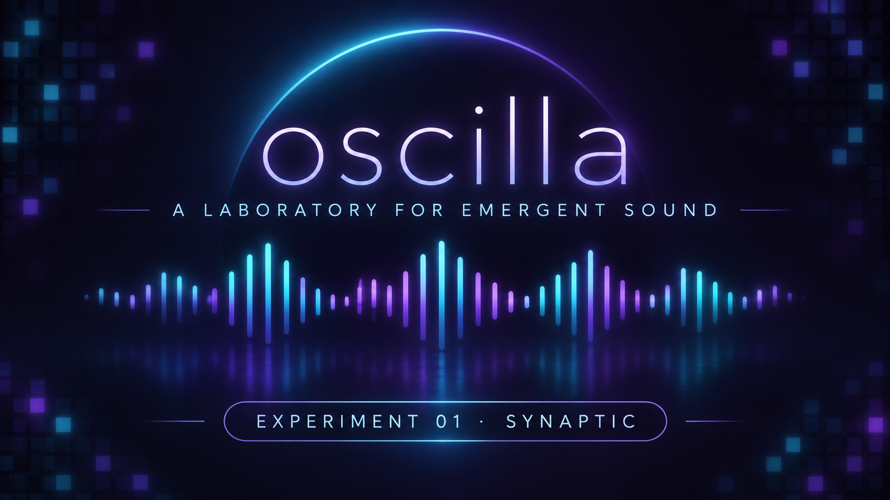

  

**Oscilla** is an experimental laboratory exploring how simple computational rules can give rise to complex patterns, movement, and sound.

Inspired by artificial life, cellular automata, complex systems, and a love of organized sound, Oscilla investigates the relationship between emergent behavior and sonic expression.

The idea is to explore what happens when these systems become not only visible, but audible. Can patterns of cellular activity become rhythms, textures, or something resembling music? What might a computational system sound like when left to evolve according to its own rules?

## Experiment 01: Synaptic

The first experiment, **Synaptic**, is based on *Brian's Brain*, a three-state cellular automaton in which cells cycle through firing, refractory, and inactive states.

Its simple rules can produce intricate, evolving patterns of activity. Synaptic will explore how those patterns can be visualized and translated into sound.

## Technology

- **Java 21:** Simulation logic and cellular automata
- **Spring Boot:** Application framework and backend
- **HTML, CSS, JavaScript:** Browser-based interface
- **Canvas API:** Visualization
- **Web Audio API:** Sound synthesis

## Status

**Early development / Work in progress**

Oscilla is intended to grow organically as a collection of small experiments in emergent audiovisual behavior. The emphasis is on curiosity, exploration, and discovering what simple systems can create.
